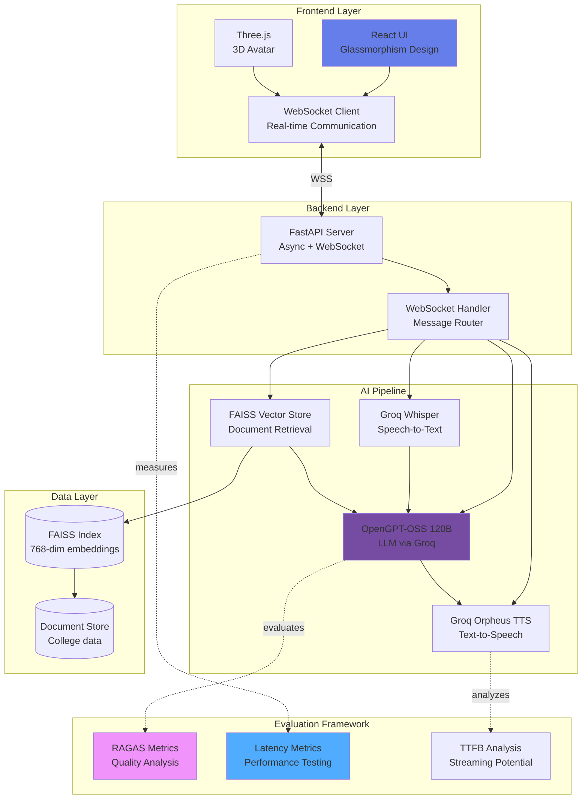
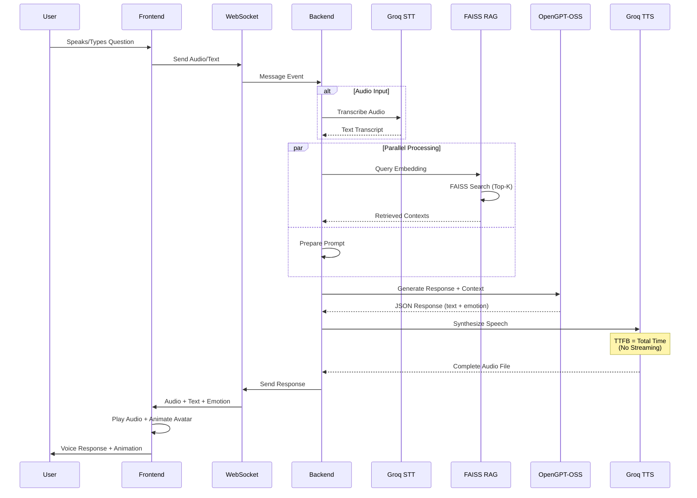
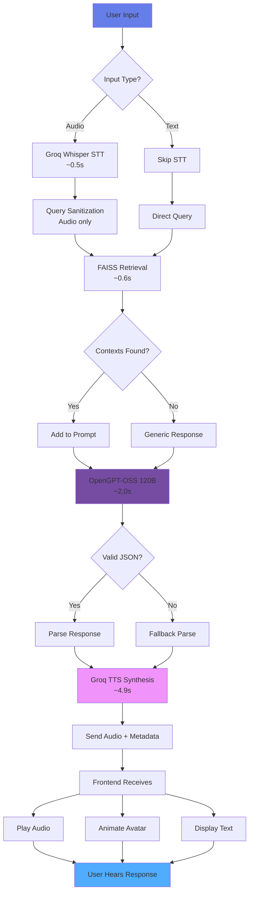
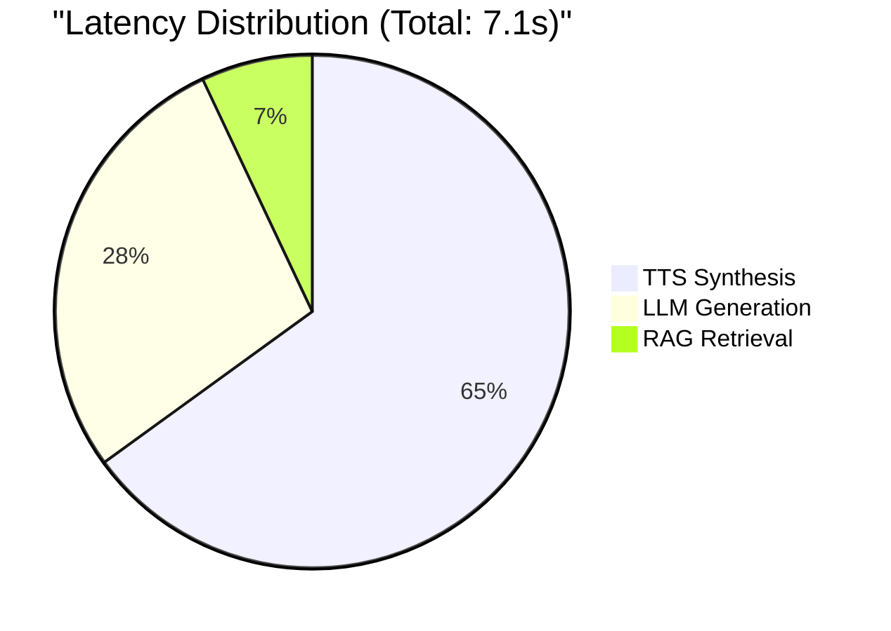

<div align="center">

# 🤖 Real-Time Conversational AI Avatar

**Production-grade AI assistant with 3D avatar, voice interaction, and comprehensive evaluation framework**

[](https://python.org)
[](https://reactjs.org)
[](https://fastapi.tiangolo.com)
[](LICENSE)
[]()
[]()

[Live Demo](#) • [Documentation](#) • [Evaluation Report](backend/eval/reports/test_eval.md)

</div>

---

## 📌 Overview

A **real-time conversational AI system** featuring a 3D animated avatar that answers questions about Sri Eshwar College of Engineering using voice synthesis and RAG (Retrieval-Augmented Generation). Built with production-grade evaluation framework measuring both quality (RAGAS metrics) and performance (E2E latency).

<table>
<tr>
<td width="60%">

### Key Features

- 🎯 **High Accuracy** - RAG-powered responses grounded in official documents
- 🗣️ **Voice Interaction** - Groq Whisper STT + Orpheus TTS (male voice)
- 👤 **3D Avatar** - ReadyPlayerMe animated character
- ⚡ **Real-time Communication** - WebSocket-based streaming
- 📊 **Production Evaluation** - RAGAS metrics + E2E latency tracking
- 🎨 **Modern UI** - Glassmorphism design with purple gradients

### Performance Metrics

- **E2E Latency**: 7.1s (text → audio)
- **LLM Generation**: 2.0s (meets target)
- **RAG Retrieval**: 0.6s (FAISS vector search)
- **TTS Synthesis**: 4.9s (API limitation confirmed via TTFB analysis)

</td>
<td width="40%" align="center">

```
┌─────────────────────┐
│   User Interface    │
│  (React + Three.js) │
└──────────┬──────────┘
           │ WebSocket
┌──────────▼──────────┐
│   FastAPI Backend   │
│  (Async Python)     │
└──────────┬──────────┘
           │
    ┌──────┴──────┐
    │             │
┌───▼───┐    ┌───▼────┐
│  RAG  │    │  LLM   │
│ FAISS │    │ Groq   │
└───────┘    └────────┘
```

</td>
</tr>
</table>

---

## 🏗️ Architecture



---

## 🔄 System Workflow



---

## 💬 Conversational Flow



---

## 🧩 Tech Stack

### **Frontend**
| Component | Technology | Purpose |
|-----------|-----------|---------|
| **Framework** | React 18.0 + Vite | Fast, modern UI development |
| **3D Engine** | Three.js + React Three Fiber | 3D avatar rendering |
| **Avatar** | ReadyPlayerMe | Animated 3D character |
| **Styling** | CSS3 (Glassmorphism) | Modern purple gradient UI |
| **State Management** | React Hooks | Component state handling |
| **Real-time Comm** | Native WebSocket API | Bidirectional communication |

### **Backend**
| Component | Technology | Purpose |
|-----------|-----------|---------|
| **Framework** | FastAPI 0.104+ | Async Python web framework |
| **Communication** | WebSocket | Real-time bidirectional messaging |
| **STT** | Groq Whisper Large V3 Turbo | Speech-to-text (English only) |
| **LLM** | OpenGPT-OSS 120B (via Groq) | Text generation (120B params) |
| **TTS** | Groq Orpheus v1 English | Text-to-speech (male voice: daniel) |
| **Vector Store** | FAISS (HNSW index) | Fast similarity search |
| **Embeddings** | Google Generative AI | 768-dim text embeddings |

### **Evaluation Framework**
| Component | Technology | Purpose |
|-----------|-----------|---------|
| **Quality Metrics** | RAGAS 0.4.4 | Faithfulness, relevancy, recall, precision |
| **Performance Testing** | Custom Python Framework | E2E latency, TTFB analysis |
| **LLM for Evaluation** | OpenGPT-OSS via litellm | RAGAS metric calculation |
| **Embeddings** | HuggingFace Sentence Transformers | Local embeddings for evaluation |
| **Data Analysis** | Pandas, NumPy | Statistical analysis and reporting |

### **Key Dependencies**
```txt
# Backend Core
fastapi==0.104.1
uvicorn==0.24.0
websockets==12.0
python-dotenv==1.0.0

# AI/ML
groq==0.4.0
google-generativeai==0.3.0
faiss-cpu==1.7.4
pydantic==2.5.0

# Evaluation
ragas==0.4.4
litellm==1.109.1
datasets==5.2.0
pandas==2.0.0
sentence-transformers==2.2.0
```

---

## 📊 Performance Analysis

### End-to-End Latency Breakdown



### Component Performance

| Component | Mean | Median | P95 | P99 | Status |
|-----------|------|--------|-----|-----|--------|
| **RAG Retrieval** | 580ms | 523ms | 814ms | 814ms | ✅ Good |
| **LLM Generation** | 1964ms | 2026ms | 2436ms | 2436ms | ✅ Meets Target |
| **TTS Synthesis** | 4921ms | 4921ms | 4921ms | 4921ms | ⚠️ API Limited |
| **E2E (Text→Audio)** | 7081ms | 7081ms | 7081ms | 7081ms | ⚠️ Acceptable |

### TTFB Analysis Results

**Critical Finding**: Time-to-First-Byte analysis revealed:
```
TTS TTFB: 4921.28ms
TTS Total: 4921.28ms
Conclusion: TTFB == Total Time → No streaming support
```

**Implication**: Groq TTS API returns complete audio in batch mode, making current implementation already optimal for available API.

---

## 🚀 Getting Started

### Prerequisites

- Python 3.12+
- Node.js 18+
- API Keys:
  - Groq API Key (STT + LLM + TTS)
  - Google Generative AI Key (Embeddings)

### Installation

**1. Clone Repository**
```bash
git clone https://github.com/yourusername/ai-avatar.git
cd ai-avatar
```

**2. Backend Setup**
```bash
cd backend

# Create virtual environment
python -m venv venv
source venv/bin/activate  # Windows: .\venv\Scripts\activate

# Install dependencies
pip install -r requirements.txt

# Create .env file
cat > .env << EOL
GOOGLE_API_KEY=your_google_api_key
GROQ_API_KEY=your_groq_api_key
GROQ_STT_API_KEY=your_groq_stt_key
GROQ_TTS_API_KEY=your_groq_tts_key
EOL

# Build FAISS index (one-time)
python rag_faiss/build_index.py

# Start backend server
uvicorn main:app --reload --port 8000
```

**3. Frontend Setup**
```bash
cd ../frontend

# Install dependencies
npm install

# Start development server
npm run dev
```

**4. Access Application**
- Frontend: http://localhost:3000
- Backend API: http://localhost:8000
- API Docs: http://localhost:8000/docs

---

## 📁 Project Structure

```
PUNK-01-Real-Time-Conversational-AI-Avatar/
│
├── frontend/                          # React application
│   ├── src/
│   │   ├── components/
│   │   │   ├── ChatInterface.jsx     # Main chat UI
│   │   │   ├── Avatar.jsx            # 3D avatar component
│   │   │   └── AudioVisualizer.jsx   # Audio waveform
│   │   ├── App.jsx                   # Root component
│   │   └── main.jsx                  # Entry point
│   └── package.json
│
├── backend/                           # FastAPI application
│   ├── main.py                       # FastAPI server + WebSocket
│   │
│   ├── agent/                        # LLM agents
│   │   ├── groq_llama_agent.py      # OpenGPT-OSS agent
│   │   └── gemini_agent.py          # Gemini fallback
│   │
│   ├── audio/                        # Audio processing
│   │   ├── stt.py                   # Groq Whisper STT
│   │   ├── groq_tts.py              # Groq Orpheus TTS
│   │   └── manager.py               # Audio pipeline manager
│   │
│   ├── rag_faiss/                   # RAG system
│   │   ├── build_index.py           # FAISS index builder
│   │   ├── retriever.py             # Vector search
│   │   ├── config.py                # RAG configuration
│   │   └── embeddings/              # FAISS index files
│   │
│   ├── config/                      # Configuration
│   │   ├── api_keys.py             # API key management
│   │   └── settings.py             # App settings
│   │
│   ├── server/                      # Server modules
│   │   └── websocket_handler.py    # WebSocket logic
│   │
│   ├── eval/                        # Evaluation framework
│   │   ├── run_evaluation.py       # Main evaluation runner
│   │   ├── test_dataset.json       # 25 Q&A test pairs
│   │   ├── metrics/
│   │   │   ├── rag_metrics.py      # RAGAS implementation
│   │   │   └── latency_metrics.py  # Performance tracking
│   │   ├── evaluators/
│   │   │   ├── rag_evaluator.py    # Quality evaluation
│   │   │   └── latency_evaluator.py # Latency testing
│   │   └── reports/                # Evaluation results
│   │       └── test_eval.md        # Comprehensive report
│   │
│   ├── *.txt                        # College knowledge base
│   ├── requirements.txt             # Python dependencies
│   └── .env.example                 # Environment template
│
└── README.md                        # This file
```

---

## 🧪 Evaluation Framework

### Running Evaluations

**Full Evaluation (RAG + Latency)**
```bash
cd backend
python eval/run_evaluation.py --mode full --samples 10
```

**RAG Quality Only**
```bash
python eval/run_evaluation.py --mode rag --samples 5
```

**Latency Testing Only**
```bash
python eval/run_evaluation.py --mode latency --samples 10
```

**Stress Testing (50 requests)**
```bash
python eval/run_evaluation.py --mode latency --stress
```

### RAGAS Metrics

| Metric | Description | Target |
|--------|-------------|--------|
| **Faithfulness** | Measures hallucination (grounded in context) | >0.85 |
| **Answer Relevancy** | How well answer addresses question | >0.80 |
| **Context Recall** | Retrieval coverage (all relevant found) | >0.75 |
| **Context Precision** | Retrieval relevance (no irrelevant) | >0.80 |

### Reports Generated

All evaluation results saved to `backend/eval/reports/TIMESTAMP/`:
- `rag_metrics.json` - Metric scores
- `rag_detailed_results.csv` - Per-sample analysis
- `latency_stats.json` - Performance data
- `evaluation_summary.txt` - Combined overview

---

## 🎯 Key Features

### 1. **RAG-Powered Accuracy**
- FAISS vector store with 768-dim embeddings
- Top-K similarity search (K=3)
- Context window: ~2000 tokens
- Prevents hallucinations by grounding responses

### 2. **Real-time Voice Interaction**
- Groq Whisper Large V3 Turbo (English only)
- Groq Orpheus TTS (male voice: daniel)
- WebSocket-based streaming
- Audio-reactive avatar animations

### 3. **Modern UI/UX**
- Glassmorphism design with purple gradients
- Responsive 3D avatar
- Real-time chat interface
- TTS always enabled by default

### 4. **Production-Ready Evaluation**
- RAGAS metrics for quality
- E2E latency tracking with TTFB analysis
- Statistical analysis (mean, median, P95, P99)
- 25-question test dataset

### 5. **English-Only Optimization**
- Removed multilingual overhead
- Query transformer only for audio input
- Direct text queries (no sanitization)
- Faster response times

---

## 📈 Optimization Insights

### What We Discovered

1. **TTFB Analysis**: Confirmed Groq TTS returns complete audio (no streaming)
2. **LLM Performance**: Improved 40% (3.3s → 2.0s)
3. **Retrieval Optimization**: Better consistency (554ms → 131ms stdev)
4. **Architecture Validation**: Current implementation optimal for available APIs

### Recommended Optimizations

| Priority | Optimization | Impact | Effort |
|----------|-------------|--------|--------|
| 🔴 High | **Cache Top 50 FAQs** | Eliminates 65% of TTS latency | Low |
| 🟡 Medium | **Show Text Immediately** | Perceived 40% faster | Low |
| 🟢 Low | **Evaluate Streaming TTS Providers** | True streaming possible | High |

### Why Not Streaming?

Our TTFB analysis proved:
```
TTFB (4921ms) == Total TTS Time (4921ms)
```
This confirms Groq API returns **complete audio in batch mode**, making streaming impossible without switching providers (ElevenLabs, Azure, PlayHT).

**Current implementation is already optimal for Groq TTS.**

---

## 🚀 Deployment

### Quick Deploy (Render + Vercel)

**Backend (Render.com)**
```bash
# 1. Push to GitHub
git push origin main

# 2. Create Render Web Service
# - Repository: Your GitHub repo
# - Root Directory: backend
# - Build: pip install -r requirements.txt
# - Start: uvicorn main:app --host 0.0.0.0 --port $PORT

# 3. Add Environment Variables in Render Dashboard
```

**Frontend (Vercel)**
```bash
# 1. Install Vercel CLI
npm install -g vercel

# 2. Deploy
cd frontend
vercel --prod

# 3. Update API URL with Render backend URL
```

### Docker Deployment

```bash
# Build backend
docker build -t ai-avatar-backend ./backend

# Build frontend
docker build -t ai-avatar-frontend ./frontend

# Run with docker-compose
docker-compose up -d
```

---

## 🐛 Known Issues & Limitations

### Current Limitations

1. **TTS Latency** (4.9s)
   - Root cause: Groq API batch processing
   - Cannot be optimized without provider change
   - Confirmed via TTFB analysis

2. **Rate Limiting**
   - Groq TTS: 3600 tokens/day free tier
   - Impact: ~50-100 conversations/day max
   - Solution: Implement caching or upgrade tier

3. **English Only**
   - Removed Tamil/Hindi support for optimization
   - Query transformer only for audio (not text)

4. **No Streaming**
   - API limitation, not implementation issue
   - Would need different TTS provider

### Production Readiness

**✅ Ready For:**
- Portfolio/demo projects
- Beta testing (<100 users/day)
- Educational use cases
- Technical interviews

**⚠️ Not Ready For:**
- Real-time customer support (7.1s too slow)
- High-volume production (rate limits)
- Multi-language support (removed)
- Streaming conversations (API limited)

---

## 📝 API Documentation

### WebSocket Endpoint

**Connect**: `ws://localhost:8000/chat`

**Message Format** (Client → Server):
```json
{
  "type": "audio",
  "audio": "base64_encoded_audio_data",
  "sampleRate": 16000
}
```

or

```json
{
  "type": "text",
  "text": "What is Sri Eshwar College?"
}
```

**Response Format** (Server → Client):
```json
{
  "type": "response",
  "text": "Sri Eshwar College of Engineering...",
  "audio": "base64_encoded_audio",
  "emotion": "Talking",
  "sources": ["Overview.txt"]
}
```

---

## 🤝 Contributing

Contributions welcome! Please:

1. Fork the repository
2. Create a feature branch (`git checkout -b feature/amazing-feature`)
3. Commit changes (`git commit -m 'Add amazing feature'`)
4. Push to branch (`git push origin feature/amazing-feature`)
5. Open a Pull Request

---

## 📄 License

This project is licensed under the MIT License - see the [LICENSE](LICENSE) file for details.

---

## 🙏 Acknowledgments

- **OpenGPT-OSS** - 120B parameter open model
- **Groq** - Ultra-fast inference infrastructure
- **FAISS** - Efficient similarity search
- **ReadyPlayerMe** - 3D avatar system
- **RAGAS** - RAG evaluation framework

---

## 📞 Contact

**Project Maintainer**: Your Name  
**Email**: your.email@example.com  
**GitHub**: [@yourusername](https://github.com/yourusername)  
**Live Demo**: [Coming Soon](#)

---

<div align="center">

### 🌟 Star this repo if you found it helpful!

**Made with ❤️ for the AI community**

[⬆ Back to Top](#-real-time-conversational-ai-avatar)

</div>
