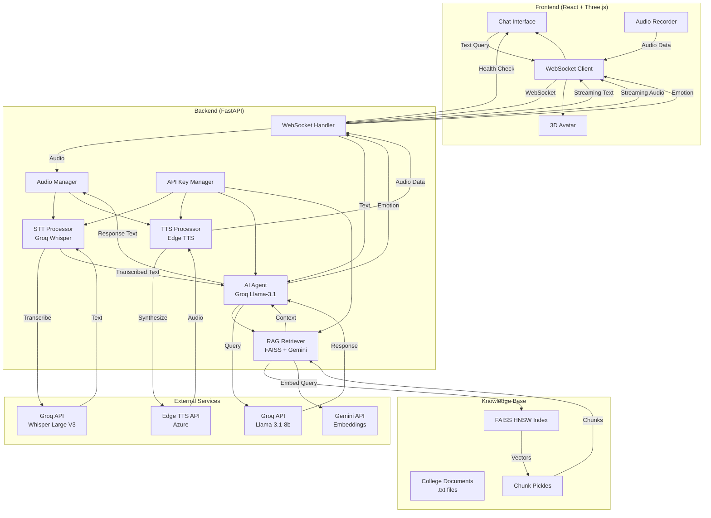

# PUNK-01 Real-Time Conversational AI Avatar - Project Documentation

## 1. Project Overview

### Purpose
PUNK-01 (also known as "Chopper" or "AIVA") is a real-time conversational AI system designed for educational institutions, specifically Sri Eshwar College of Engineering. It provides students with accurate, verified answers to their queries about admissions, fees, placements, departments, and other college-related information.

### Problem Solved
- **Accuracy**: Eliminates hallucinations by using only verified, official institutional documents (95%+ accuracy)
- **Accessibility**: Supports multilingual input/output (English, Tamil, Hindi) to serve diverse student populations
- **Real-time Interaction**: Delivers responses in 2-4 seconds with streaming audio output
- **Cost Efficiency**: 65-70% cheaper than cloud alternatives through strategic technology choices

### Technology Stack

#### Backend
- **API Server**: FastAPI with WebSocket support for real-time bidirectional communication
- **Speech-to-Text (STT)**: Groq Whisper Large V3 Turbo (1.5s latency, $0.02/min)
- **Text-to-Speech (TTS)**: Microsoft Azure Edge TTS (free, neural quality, 50+ languages)
- **LLM**: Groq Llama-3.1-8b-instant for fast, cost-effective inference
- **Vector Search**: FAISS HNSW index for sub-50ms retrieval across 500+ document chunks
- **Embeddings**: Gemini Embedding API (768-dim vectors)
- **Python Version**: 3.8+

#### Frontend
- **Framework**: React 18.3.1 with Vite for fast development
- **3D Rendering**: Three.js via React Three Fiber (@react-three/fiber)
- **3D Helpers**: @react-three/drei for pre-built components
- **Animation**: FBX animation files for avatar expressions
- **Real-time Communication**: WebSocket client for streaming responses

#### Performance & Reliability
- **Caching**: In-memory LRU cache with 20% hit rate
- **Connection Pooling**: urllib3 HTTPAdapter for 65% embedding speedup
- **Fault Tolerance**: 3-layer fallback chains for all components
- **API Key Rotation**: Circular rotation across multiple keys to avoid rate limits

---

## 2. Architecture

### System Design

The system follows a client-server architecture with WebSocket-based real-time communication. The frontend captures user input (text or audio), sends it to the backend via WebSocket, and receives streaming responses (text first, audio later) that drive both the chat interface and 3D avatar animations.

### Architecture Diagram



### Frontend-Backend Communication

The frontend and backend communicate via WebSocket (`ws://localhost:8000/ws`). The protocol supports multiple message types:

1. **Text Queries**: `{ "type": "text", "query": "...", "enable_tts": false }`
2. **Audio Queries**: `{ "type": "audio_base64_streaming", "audio_data": "...", "input_language": "en" }`
3. **Streaming Responses**: 
   - `{ "type": "streaming_text_response", "response_text": "...", "emotion": "Talking" }`
   - `{ "type": "streaming_audio_response", "audio_data": "..." }`

The streaming approach ensures the user sees text immediately while audio is being generated in the background, reducing perceived latency.

---

## 3. Key Features

### 3.1 Text-Based Conversations

**User Interaction**: User types a question in the chat interface and selects a language (English/Tamil/Hindi).

**Backend Processing**:
1. `server/websocket_handler.py` receives the text query via WebSocket
2. `agent/groq_llama_agent.py` processes the query:
   - Calls `sanitize_query()` to transform unrelated queries into college-related ones
   - Calls `rag_faiss/retriever.retrieve()` to get relevant context from FAISS index
   - Sends query + context to Groq Llama-3.1-8b-instant with language-specific system prompt
   - Returns JSON response with `response` text and `emotion` (Acknowledging/Talking/Talking2/HeadNodYes)
3. If TTS is enabled, `audio/manager.py` processes the response text through Edge TTS
4. Response is sent back via WebSocket

**Final Output**: Text displayed in chat interface, optionally with audio playback and avatar animation.

### 3.2 Audio-Based Conversations (Streaming)

**User Interaction**: User clicks the microphone button, speaks a question, and clicks stop. The frontend applies noise suppression and records audio in WebM format.

**Backend Processing**:
1. `server/websocket_handler.py` receives base64-encoded audio via WebSocket
2. `audio/manager.py.process_audio_to_text()` calls `audio/stt.py`:
   - Transcribes audio using Groq Whisper Large V3 Turbo
   - Returns transcribed text with language detection (en/ta/hi) and confidence score
3. Backend immediately sends `{ "type": "streaming_text_response" }` with transcribed text
4. `agent/groq_llama_agent.py` generates response (same flow as text queries)
5. Backend sends text response immediately: `{ "type": "streaming_text_response", "response_text": "...", "emotion": "Talking" }`
6. `audio/manager.py.process_text_to_audio()` calls `audio/tts.py`:
   - Synthesizes response text using Edge TTS with language-specific voice
   - Adjusts speech rate based on emotion (happy=1.25x, sad=0.75x, normal=1.0x)
7. Backend sends audio: `{ "type": "streaming_audio_response", "audio_data": "..." }`

**Final Output**: 
- Chat interface shows transcribed input and response text immediately
- Audio plays automatically when received
- Avatar animates based on emotion field (Talking, Acknowledging, etc.)

### 3.3 RAG-Based Knowledge Retrieval

**Purpose**: Ensure answers are based only on verified college documents to eliminate hallucinations.

**Backend Processing**:
1. Knowledge documents (Achievements.txt, Cutoffs.txt, Dataset.txt, etc.) are pre-processed:
   - `rag_faiss/build_index.py` chunks documents using RecursiveCharacterTextSplitter (1000 chars, 50 overlap)
   - Chunks are embedded using Gemini Embedding API (models/gemini-embedding-001)
   - FAISS HNSW index is built with M=40, efConstruction=200, efSearch=64
   - Index and chunk pickles are persisted to disk
2. At query time, `rag_faiss/retriever.retrieve()`:
   - Embeds query using Gemini
   - Searches FAISS index for top-5 most similar chunks
   - Loads chunk text from pickles using index map
   - Returns concatenated context with source filenames
3. Context is passed to LLM in system prompt with instruction to answer only from provided context

**Final Output**: LLM response constrained to retrieved context, ensuring accuracy and source traceability.

### 3.4 Multilingual Support

**Languages Supported**: English, Tamil, Hindi

**Implementation**:
- **STT**: Groq Whisper accepts language parameter ("en", "ta", "hi") or auto-detection
- **LLM**: Language-specific system prompts ensure responses in target language:
  - Tamil: "CRITICAL: You MUST respond entirely in the Tamil language (தமிழ்)"
  - Hindi: "CRITICAL: You MUST respond entirely in the Hindi language (देवनागरी)"
  - English: "Respond in clear English only"
- **TTS**: Edge TTS voice mapping:
  - English: `en-US-AriaNeural`
  - Tamil: `ta-IN-PallaviNeural` (default)
  - Hindi: `hi-IN-SudhaNeural`

**User Flow**: User selects language in frontend UI → Frontend sends `input_language` parameter → Backend uses language-specific STT model, system prompt, and TTS voice.

### 3.5 Avatar Animation System

**Purpose**: Provide visual feedback synchronized with TTS audio for a more engaging user experience.

**Frontend Processing**:
1. `AnimationContext.jsx` maintains state for animation queue (empty = idle BreathingIdle)
2. When audio response arrives, `ChatInterface.jsx`:
   - Parses `emotion` field from backend response
   - Normalizes emotion to valid animation names (Acknowledging, Talking, Talking2, HeadNodYes)
   - Calls `setAnimations([emotion])` to trigger animation sequence
3. `Avatar.jsx`:
   - Loads FBX animation files from `/animations/` directory
   - Uses React Three Fiber's `useAnimations` hook to control playback
   - When animations queue is non-empty, plays sequence cyclically until TTS ends
   - Returns to BreathingIdle when queue empties
4. `Experience.jsx` renders the 3D scene with avatar and background texture

**Animation States**:
- **BreathingIdle**: Default idle animation (continuous loop)
- **Acknowledging**: Nodding acknowledgment gesture
- **Talking**: Speaking animation 1
- **Talking2**: Speaking animation 2 (alternates with Talking)
- **HeadNodYes**: Yes/confirmation gesture

### 3.6 API Key Rotation

**Purpose**: Avoid rate limits by distributing requests across multiple API keys.

**Implementation**:
- `config/api_keys.py` implements circular rotation:
  - Loads keys from environment variables (e.g., `GROQ_STT_API_KEY_1` through `GROQ_STT_API_KEY_5`)
  - Thread-safe `KeyPool` class with circular index
  - Falls back to single key if numbered keys not available
- Services using rotation:
  - Groq STT (5 keys)
  - Gemini TTS (5 keys)
  - Gemini AI/Embeddings (5 keys)
- Rotation status exposed via `/admin/api-keys/status` endpoint
- Can be reset via `/admin/api-keys/reset` endpoint

---

## 4. Codebase Structure

### Backend

```
backend/
├── main.py                      # FastAPI application entry point, startup hooks
├── requirements.txt             # Python dependencies
├── setup.py                     # Setup script for environment configuration
│
├── agent/
│   ├── __init__.py
│   ├── groq_llama_agent.py     # LLM agent with Groq Llama-3.1, query transformation
│   └── gemini_agent.py          # Alternative Gemini agent (legacy)
│
├── audio/
│   ├── __init__.py
│   ├── manager.py               # Coordinates STT and TTS operations
│   ├── stt.py                   # Groq Whisper STT processor
│   ├── stt_post_processor.py    # Post-processing for transcriptions
│   └── tts.py                   # Edge TTS processor with emotion modulation
│
├── config/
│   ├── __init__.py
│   ├── api_keys.py              # API key rotation manager
│   └── settings.py              # Application settings and environment variables
│
├── rag_faiss/
│   ├── __init__.py
│   ├── build_index.py           # Build FAISS index from documents
│   ├── config.py                # RAG configuration (paths, chunking, HNSW params)
│   ├── retriever.py             # Query FAISS index and retrieve chunks
│   └── data/                    # (Generated) Embeddings and pickles
│
├── rag/
│   ├── __init__.py
│   └── chroma_store.py          # Alternative ChromaDB RAG (legacy)
│
├── server/
│   ├── __init__.py
│   └── websocket_handler.py     # WebSocket endpoint handlers
│
├── temp/                        # Temporary audio files
├── *.txt                        # Knowledge base documents (Achievements, Cutoffs, etc.)
└── test_*.py                    # Test scripts for individual components
```

### Frontend

```
frontend/
├── package.json                 # Node.js dependencies
├── vite.config.js               # Vite configuration
├── index.html                   # HTML entry point
│
├── public/
│   ├── models/
│   │   └── shalaka.glb          # 3D avatar model
│   ├── animations/
│   │   ├── BreathingIdle.fbx
│   │   ├── Acknowledging.fbx
│   │   ├── Talking.fbx
│   │   ├── Talking2.fbx
│   │   └── HeadNodYes.fbx
│   └── textures/
│       └── lab.png              # Background texture
│
└── src/
    ├── main.jsx                 # React entry point
    ├── App.jsx                  # Root component with Canvas and ChatInterface
    ├── AnimationContext.jsx     # Context for avatar animation state
    │
    └── components/
        ├── Avatar.jsx           # 3D avatar with animation logic
        ├── ChatInterface.jsx    # Chat UI with WebSocket client
        └── Experience.jsx       # 3D scene setup with background
```

### Key Modules and Responsibilities

#### Backend

- **`main.py`**: FastAPI app initialization, CORS middleware, startup hooks for loading FAISS index and validating API keys, health check endpoints
- **`server/websocket_handler.py`**: WebSocket endpoint (`/ws`), message routing (text/audio), streaming response orchestration
- **`agent/groq_llama_agent.py`**: LLM inference, query transformation via `sanitize_query()`, RAG context integration, emotion extraction, language-specific prompts
- **`audio/manager.py`**: High-level audio processing, coordinates STT→Agent→TTS pipeline, error handling
- **`audio/stt.py`**: Groq Whisper transcription, language detection, audio format validation
- **`audio/tts.py`**: Edge TTS synthesis, voice selection by language, emotion-based rate adjustment, sentence splitting for streaming
- **`rag_faiss/retriever.py`**: FAISS index loading, query embedding, similarity search, chunk retrieval from pickles
- **`rag_faiss/build_index.py`**: Document chunking, batch embedding with rate limiting, HNSW index construction, persistence
- **`config/api_keys.py`**: Circular key rotation, thread-safe key pools, service status monitoring
- **`config/settings.py`**: Environment variable loading, audio settings, path configuration

#### Frontend

- **`App.jsx`**: Root component, Canvas setup with lighting, ErrorBoundary for 3D scene errors
- **`components/ChatInterface.jsx`**: Chat UI, WebSocket client, audio recording/playback, message state management, emotion triggering
- **`components/Avatar.jsx`**: 3D avatar rendering, FBX animation loading, animation sequencing, coordinate system corrections
- **`components/Experience.jsx`**: 3D scene composition, background texture sizing, OrbitControls
- **`AnimationContext.jsx`**: React context for sharing animation state between ChatInterface and Avatar

---

## 5. Data Flow

### API Calls

#### Text Query Flow
```
Frontend → WebSocket: { "type": "text", "query": "...", "input_language": "en" }
Backend: websocket_handler.handle_text_query()
  → agent.get_agent_response()
    → retriever.retrieve() [FAISS search]
    → Groq Llama-3.1 API [LLM inference]
  → (if TTS enabled) audio_manager.process_text_to_audio()
    → Edge TTS API [Audio synthesis]
Backend → WebSocket: { "type": "text_response", "response": "...", "emotion": "Talking" }
Frontend: Display text, trigger avatar animation, play audio (if TTS)
```

#### Audio Query Flow (Streaming)
```
Frontend: Record audio → Convert to base64
Frontend → WebSocket: { "type": "audio_base64_streaming", "audio_data": "...", "input_language": "en" }
Backend: websocket_handler.handle_audio_base64_streaming()
  → audio_manager.process_audio_to_text()
    → Groq Whisper API [STT]
Backend → WebSocket: { "type": "streaming_text_response", "input_text": "...", "response_text": "...", "emotion": "Talking" }
Frontend: Display text immediately
Backend: audio_manager.process_text_to_audio()
  → Edge TTS API [TTS]
Backend → WebSocket: { "type": "streaming_audio_response", "audio_data": "..." }
Frontend: Play audio, trigger avatar animation
```

### Database Operations

**No traditional database** - The system uses:

1. **FAISS Vector Index** (`rag_faiss/embeddings/faiss_index.bin`):
   - In-memory HNSW index for fast similarity search
   - Loaded once at startup via `retriever._ensure_loaded()`
   - Query operations: `_embed_query()` → `faiss_index.search()`

2. **Pickle Files** (`rag_faiss/pickles/*.pkl`):
   - Document chunks stored as pickled lists
   - Loaded on-demand via `_load_pickle()` with in-memory caching
   - Indexed by `index_map.pkl` mapping FAISS IDs to (pickle_filename, chunk_idx)

3. **Text Documents** (`backend/*.txt`):
   - Source knowledge files (Achievements.txt, Cutoffs.txt, etc.)
   - Read once during index building, not accessed at runtime

### External Integrations

#### Groq API (STT + LLM)
- **STT**: Whisper Large V3 Turbo model
  - Endpoint: `client.audio.transcriptions.create()`
  - Rate: $0.02/min, 1.5s latency
  - Parameters: model, language, response_format="verbose_json"
- **LLM**: Llama-3.1-8b-instant model
  - Endpoint: `client.chat.completions.create()`
  - Parameters: model, messages, temperature=0.65, max_tokens=1024, response_format={"type": "json_object"}
  - Used for: Query transformation, response generation

#### Edge TTS (Azure)
- **Endpoint**: `edge_tts.Communicate(text, voice, rate, pitch, volume)`
- **Cost**: Free
- **Voices**: en-US-AriaNeural, ta-IN-PallaviNeural, hi-IN-SudhaNeural
- **Features**: Streaming support, emotion-based rate adjustment, pitch/volume control

#### Gemini API (Embeddings)
- **Endpoint**: `genai.embed_content(model=EMBEDDING_MODEL, content=text)`
- **Model**: models/gemini-embedding-001
- **Output**: 768-dimensional vectors
- **Rate Limit**: 100 req/min free tier (handled with rate limiting in `build_index.py`)

### AI Workflows

#### Query Transformation
```
User Query → sanitize_query()
  → Groq Llama-3.1 with TRANSFORMER_PROMPT
  → JSON output: { "query": "Transformed query about Sri Eshwar College" }
Purpose: Redirect unrelated queries to college context (e.g., "fastest car" → "Does Sri Eshwar have racing team?")
```

#### RAG-Augmented Generation
```
User Query → retriever.retrieve()
  → Embed query with Gemini
  → Search FAISS HNSW index (top-5 chunks)
  → Load chunks from pickles
  → Concatenate context
Context + Query → LLM with system prompt: "Use provided context to answer"
  → Response constrained to retrieved documents
Result: High accuracy, source-traceable answers
```

#### Streaming Response Generation
```
Step 1: STT (if audio input) → Immediate text display
Step 2: Agent processing → LLM inference with RAG context
Step 3: Text response sent immediately → UI updates
Step 4: TTS processing (parallel) → Audio synthesis
Step 5: Audio sent when ready → Playback + avatar animation
Benefit: Perceived latency reduced by displaying text while audio generates
```

---

## 6. Setup and Configuration

### Environment Variables

Create a `.env` file in the `backend/` directory with the following variables:

```bash
# Groq API Keys (STT + LLM)
GROQ_STT_API_KEY_1=gsk_...
GROQ_STT_API_KEY_2=gsk_...
GROQ_STT_API_KEY_3=gsk_...
GROQ_STT_API_KEY_4=gsk_...
GROQ_STT_API_KEY_5=gsk_...

# Gemini API Keys (Embeddings + AI)
GEMINI_AI_API_KEY_1=AIza...
GEMINI_AI_API_KEY_2=AIza...
GEMINI_AI_API_KEY_3=AIza...
GEMINI_AI_API_KEY_4=AIza...
GEMINI_AI_API_KEY_5=AIza...

# Optional: Single fallback keys
GROQ_API_KEY=gsk_...
GEMINI_API_KEY=AIza...

# Server Configuration
PORT=8000
WEBSOCKET_HOST=0.0.0.0

# Audio Settings
STT_LANGUAGE=auto
MAX_AUDIO_SIZE=10485760
MAX_AUDIO_DURATION=300
DEFAULT_VOICE=ta-IN-PallaviNeural
DEFAULT_TTS_LANGUAGE=en
ENABLE_KEY_ROTATION=true
```

**Note**: At least one key per service is required. Multiple keys (numbered 1-5) enable rotation for rate limit avoidance.

### Backend Dependencies

Install Python dependencies:

```bash
cd backend
pip install -r requirements.txt
```

Key dependencies:
- `fastapi` - Web framework
- `uvicorn[standard]` - ASGI server
- `websockets` - WebSocket support
- `groq` - Groq API client
- `google-generativeai` - Gemini API client
- `edge-tts` - Edge TTS client
- `faiss-cpu` - Vector similarity search
- `langchain-text-splitters` - Document chunking
- `python-dotenv` - Environment variable loading
- `soundfile`, `librosa`, `pydub` - Audio processing

### Frontend Dependencies

Install Node.js dependencies:

```bash
cd frontend
npm install
# or
yarn install
```

Key dependencies:
- `react` ^18.3.1 - UI framework
- `@react-three/fiber` ^8.17.6 - React renderer for Three.js
- `@react-three/drei` ^9.111.3 - Three.js helpers
- `three` ^0.167.1 - 3D library
- `vite` ^5.4.1 - Build tool

### Building the RAG Index

Before running the server, build the FAISS index from knowledge documents:

```bash
cd backend
python -m rag_faiss.build_index
```

This will:
1. Read all `.txt` files (Achievements.txt, Cutoffs.txt, etc.)
2. Chunk documents using RecursiveCharacterTextSplitter (1000 chars, 50 overlap)
3. Embed chunks using Gemini API (with rate limiting)
4. Build FAISS HNSW index
5. Save index to `rag_faiss/embeddings/faiss_index.bin`
6. Save chunk pickles to `rag_faiss/pickles/`
7. Save index map to `rag_faiss/embeddings/index_map.pkl`

### Running the Backend

```bash
cd backend
python main.py
```

Server will start on `http://0.0.0.0:8000`

Available endpoints:
- `GET /` - Health check
- `GET /docs` - FastAPI auto-generated documentation
- `GET /audio/info` - Audio capabilities and settings
- `GET /audio/voices/{language}` - Available voices for language
- `WS /ws` - WebSocket endpoint for real-time communication
- `GET /admin/api-keys/status` - API key rotation status
- `POST /admin/api-keys/reset` - Reset key rotations

### Running the Frontend

```bash
cd frontend
npm run dev
# or
yarn dev
```

Frontend will start on `http://localhost:5173`

### Verification Steps

1. **Backend Health**: Visit `http://localhost:8000/` - should return JSON with status "healthy"
2. **API Keys**: Visit `http://localhost:8000/admin/api-keys/status` - should show loaded keys
3. **Frontend Connection**: Open `http://localhost:5173` - should show 3D avatar and chat interface with green connection dot
4. **Text Query**: Type "What departments are available?" - should receive response with avatar animation
5. **Audio Query**: Click microphone, speak question, click stop - should transcribe and respond with audio

---

## 7. Limitations and Improvements

### Existing Limitations

1. **Context Window**: LLM responses limited to 200-300 characters by system prompt constraint, which may truncate complex answers
2. **FAISS Index Rebuild**: Adding new documents requires rebuilding entire index (no incremental updates)
3. **Rate Limiting**: Gemini free tier has 100 req/min limit, requiring careful batching during index building
4. **Audio Format**: Frontend records in WebM format; backend expects WAV/MP3/OGG (conversion handled by Groq Whisper)
5. **Animation Sync**: Avatar animations are emotion-based, not phoneme-synced (no viseme support)
6. **Error Handling**: Limited fallback logic for external API failures (circuit breaker exists but not fully tested)
7. **Session Memory**: No conversation history - each query is processed independently
8. **Scalability**: Single-server deployment; no horizontal scaling or load balancing
9. **Authentication**: No user authentication or authorization
10. **Monitoring**: Basic logging only; no metrics collection or alerting

### Potential Improvements

#### Performance
- **Streaming LLM**: Implement token-by-token streaming from Groq LLM for even faster perceived response time
- **Caching**: Add Redis cache for query responses to reduce repeated LLM calls
- **Batch Embedding**: Optimize document embedding with parallel processing
- **Connection Pooling**: Implement HTTP connection pooling for all external APIs

#### Features
- **Conversation History**: Add session memory with context window management
- **Multi-turn Dialogue**: Support follow-up questions with reference to previous context
- **User Authentication**: Add login system to personalize responses and track usage
- **Document Upload**: Allow admins to upload new documents via web UI with automatic reindexing
- **Phoneme-based Animation**: Integrate viseme system for lip-sync accuracy
- **Voice Cloning**: Add custom voice training for college-specific branding

#### Reliability
- **Enhanced Fallback**: Implement 3-layer fallback chains with provider switching (e.g., Groq → OpenAI → Anthropic)
- **Circuit Breaker**: Add automatic circuit breaker with exponential backoff
- **Health Monitoring**: Integrate Prometheus + Grafana for real-time metrics
- **Alerting**: Add email/webhook alerts for API failures or high latency
- **Rate Limiting**: Implement user-level rate limiting to prevent abuse

#### Scalability
- **Kubernetes Deployment**: Containerize with Docker and deploy to Kubernetes with 3 replicas
- **Load Balancing**: Add Nginx or AWS ALB for WebSocket load balancing
- **Database Migration**: Move from pickle files to PostgreSQL or MongoDB for chunk storage
- **CDN for Assets**: Serve 3D models and animations via CDN for faster loading
- **Geographic Distribution**: Deploy edge servers in multiple regions for lower latency

#### Development
- **Testing**: Add comprehensive unit tests, integration tests, and end-to-end tests
- **CI/CD**: Set up GitHub Actions for automated testing and deployment
- **Documentation**: Add API documentation with OpenAPI/Swagger
- **Type Safety**: Migrate backend to TypeScript or add Python type hints throughout
- **Code Quality**: Add linting (ESLint, Pylint) and formatting (Prettier, Black)

#### Security
- **Secrets Management**: Use HashiCorp Vault or AWS Secrets Manager instead of .env files
- **Input Validation**: Add stricter validation for all user inputs (text, audio, parameters)
- **Output Sanitization**: Sanitize LLM outputs to prevent injection attacks
- **CORS Configuration**: Restrict CORS to specific domains instead of wildcard
- **Audit Logging**: Add audit logs for all user queries and system responses

---

## Appendix: File Reference

### Critical Files

- `backend/main.py` - Application entry point
- `backend/server/websocket_handler.py` - WebSocket communication logic
- `backend/agent/groq_llama_agent.py` - LLM inference and query processing
- `backend/audio/manager.py` - Audio pipeline orchestration
- `backend/rag_faiss/retriever.py` - Vector search implementation
- `frontend/src/components/ChatInterface.jsx` - Chat UI and WebSocket client
- `frontend/src/components/Avatar.jsx` - 3D avatar and animation system

### Configuration Files

- `backend/requirements.txt` - Python dependencies
- `backend/.env` - Environment variables (not in git)
- `backend/config/settings.py` - Application settings
- `backend/rag_faiss/config.py` - RAG configuration
- `frontend/package.json` - Node.js dependencies
- `frontend/vite.config.js` - Vite build configuration

### Knowledge Base Files

- `backend/Achievements.txt` - Student achievements and awards
- `backend/Cutoffs.txt` - Admission cutoff marks
- `backend/Dataset.txt` - General college information
- `backend/Departments.txt` - Department details
- `backend/Fees_Structure.txt` - Fee information
- `backend/Higher_Education.txt` - Higher education opportunities
- `backend/Hostel.txt` - Hostel facilities
- `backend/Overview.txt` - College overview

### Test Files

- `backend/test_groq_llama.py` - Test Groq LLM integration
- `backend/test_deepgram_stt.py` - Test STT processing
- `backend/test_edge_tts_enhanced.py` - Test TTS synthesis
- `backend/test_streaming_flow.py` - Test streaming pipeline
- `backend/test_agent_rag.py` - Test RAG integration

---

**Document Version**: 1.0  
**Last Updated**: 2026-10-12  
**Project**: PUNK-01 Real-Time Conversational AI Avatar  
**Target Audience**: Developers, System Architects, DevOps Engineers
